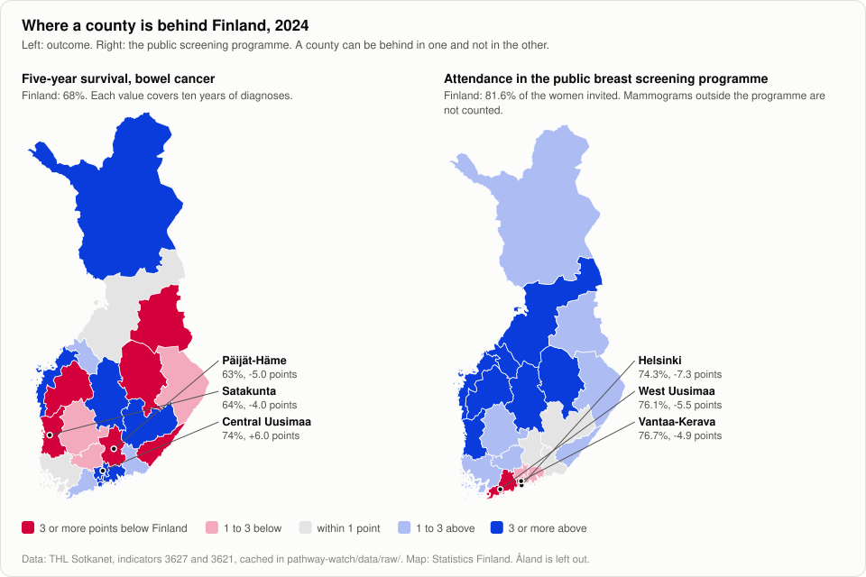
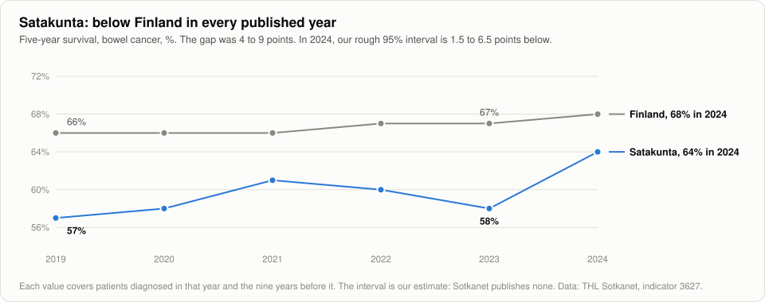
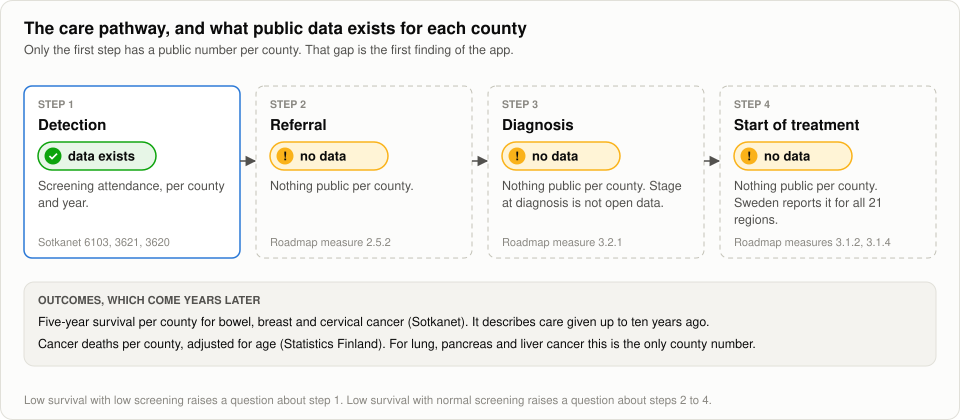
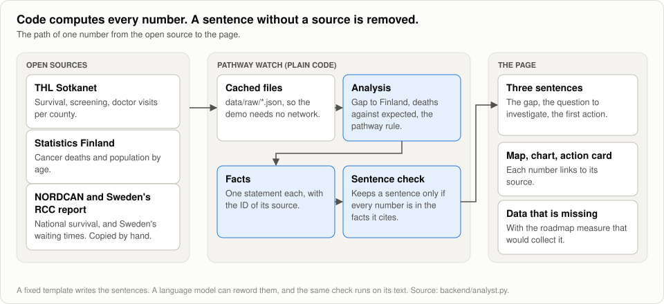

# Handbook: Cancer Care Atlas

This handbook explains the AstraZeneca entry to anyone on the team. The build brief is `PATHWAY_PLAN.md`.

## What it is

Cancer Care Atlas is for a decision-maker in a Finnish wellbeing services county. In under two minutes it shows three things. First, where cancer patients in the county are behind the rest of Finland. Second, which step of the care pathway to ask questions about. Third, which measure of the national roadmap to act on first. Every number links to its source.

The design rule: code computes every number. If a number in a sentence is not in the facts that the sentence cites, the app removes the sentence.

## The map

| Finding | Value | Years |
|---|---|---|
| Helsinki has the lowest attendance in the public breast screening programme | 74.3% in 2024, Finland 81.6% | Every published year, 2015 to 2024 |
| The three lowest counties for that attendance are all in Uusimaa | Helsinki, West Uusimaa, Vantaa-Kerava in 2024 | Every published year, 2015 to 2024 |
| Satakunta has the lowest bowel cancer survival | 57% to 61%, Finland 66% to 67% | 2019 to 2023 |
| Satakunta is 4 points below Finland in bowel cancer survival | 64%, Finland 68%. Our rough 95% interval: 6.3 to 1.7 points below. With the stricter limit for 22 counties: 7.6 to 0.4 points below | 2024 |
| Päijät-Häme has the lowest bowel cancer survival | 63%, Finland 68%. Our rough 95% interval: 7.4 to 2.6 points below | 2024 only. It is below Finland in 4 of 6 years |

The attendance figure counts the public programme only. A mammogram in occupational or private care is not in it. A Finnish Cancer Registry study (Fuhrmann and others, Acta Oncologica 2024) counted such mammograms for the whole country. Upper-level employees had them about twice as often as manual workers. So low attendance in Helsinki does not show how many women have no mammogram at all.

The lowest of 22 counties tends to look less extreme the next time it is measured. This effect is called regression to the mean. So the interval matters more than the rank.

## Why the app asks questions and does not name causes

Survival in the app is the five-year relative survival of Sotkanet, standardised by age. It compares the patients with people of the same age in the region. Each survival value covers patients diagnosed in that year and the nine years before. Two neighboring years share most of their patients. So the app does not average years, and it does not call agreement between years "confidence".

The evidence for a survival gap is a rough 95% interval that the app computes from patient counts. Example: Satakunta has about 187 new bowel cancer cases per year, so one survival value covers about 1,870 patients. The standard error of the gap is then 1.2 points. The gap of 4 points has an interval from 6.3 to 1.7 points below Finland, so it excludes zero.

The app compares 22 counties with Finland. So about one 95% interval excludes zero by chance alone. The app also computes each interval with a stricter limit for 22 comparisons (the Bonferroni correction: 3.05 standard errors in place of 1.96). For bowel cancer, 7 counties have a survival gap that excludes zero, and 3 of them hold the stricter limit: Satakunta, Päijät-Häme and North Savo. The page marks the other gaps with "may be chance among 22 counties".

This interval is our estimate, and the true interval is wider. Sotkanet publishes no interval. Relative survival varies more than a plain share. The county case count is an estimate: the national count times the county's share by age structure. Satakunta holds 3.7% of the people and 4.6% of the bowel cancer deaths that its age structure predicts, so the app gives it 4.6% of the cases. The age pattern of deaths stands in for the age pattern of new cases, and patients die at an older age than they are diagnosed. So the estimate is somewhat high for an old county. The page says all of this next to the number. The count "below in 6 of 6 years" stays on the page as a description only.

The pathway rule compares counties, not patients. For breast and cervical cancer, low survival with low attendance in the public screening programme raises a question about detection. Low survival with normal attendance raises a question about the later steps. Public data cannot tell the later steps apart, and the app says so.

Bowel cancer is different. National bowel screening started in 2022. Each survival value covers ten years of diagnoses, so most of those patients were diagnosed before the programme. Attendance cannot explain their survival. For a bowel cancer survival gap, the app says that the data cannot tell which step the gap comes from. Low attendance in the new programme is shown as an early warning of its own.

When the step is open, the first action is not an intervention. It is a pathway audit: the county counts the days in each step for last year's patients. The audit is useful whichever step is slow. Then the county picks the roadmap measure for the slowest step: 1.3.2 if patients come late, 2.5.2 if the delay is before referral, 3.1.2 if it is in diagnosis or treatment. The page lists these three as candidates, each with the finding that would choose it.

## The waits before treatment, and the intended use

### What the sources say about waits

Before treatment, a patient needs tests, for example a colonoscopy, a tissue sample and a scan. The national roadmap counts the whole wait from referral to treatment, not the wait for each test.

1. The wait matters. In a review of 34 studies, each four-week delay of cancer surgery went with a 6% to 8% higher risk of death ([Hanna and others, BMJ 2020](https://doi.org/10.1136/bmj.m4087)). For radiotherapy the result differed by cancer: 9% for head and neck cancer, and no clear effect after breast-conserving surgery.
2. In a survey of Nordic lung cancer professionals, Finland had the lowest access to CT from primary care and the longest waits in primary care ([Khalife and others, Acta Oncologica 2025](https://doi.org/10.2340/1651-226X.2025.42778)). The survey holds the views of professionals, not measured waits. One author works for the drug company MSD. The app cites it on the lung cancer view only.
3. Between 47% and 53% of new cancer patients need radiotherapy at least once ([Borras and others, Radiotherapy and Oncology 2015](https://doi.org/10.1016/j.radonc.2015.04.018)). The app has no treatment data.

We found no public source that gives the wait for any of these tests per county. So the app lists these waits as missing data. We do not claim that one test is the slow step in any county.

### Intended use

Cancer Care Atlas answers a planner's question about a county. It gives no advice about one patient. The EU guidance on medical software, [MDCG 2019-11 revision 1 of June 2025](https://health.ec.europa.eu/document/download/b45335c5-1679-4c71-a91c-fc7a4d37f12b_en), says in decision step 4 that software "intended only to aggregate population data" is not for the benefit of individual patients. We read this to mean that Cancer Care Atlas is not a medical device. This is our reading. No regulatory expert reviewed it, so the pitch does not claim it.

Patient-level register data needs a permit from Findata, the Finnish permit authority for health data.

## How a number reaches the page

## Run it

Run every command from `pathway-watch/`. You need `uv`.

1. Start the app: `uv run uvicorn backend.app:app --port 8010`.
2. Open `http://localhost:8010`.
3. Run the tests: `uv run pytest`. 92 tests pass.
4. To refresh the open data, run `uv run python data/fetch_sotkanet.py` and `uv run python data/fetch_statfin.py`. The cached data and the two fonts are in the repository, so the demo needs no network. A test checks that the page loads nothing from outside.

Set `PATHWAY_LLM=0` for the demo. Then the fixed template writes the three sentences. The language model path is not tested with a real key.

The server loads its code and its data once. If a file changes after that, the page shows a notice above the views and asks for a restart. Stop the server with Ctrl+C and start it again. Do this before the demo on every port that you use.

## The screening campaign

The view Decision has a part "Screening campaign". It answers one question: who gets a reminder, and why.

The county runs a campaign when its attendance in the public programme is below the 80% target of the strategy. A person is in the campaign when three answers are yes:

1. The person is in the age and sex group of the national programme. The field is the date of birth and the sex.
2. The person lives in the county. The field is the home municipality.
3. The programme invited the person in this round and has no test in the programme on the reply date. The fields are the invitation and the test of this round.

If the county cannot remind everyone at once, it starts with the people who have never taken part. That order uses one more field: the invitation and the test of the earlier rounds.

All fields are the programme's own records. We did not confirm with a county which register holds each field. No rule reads a diagnosis, a medicine, a visit, income, education or language.

The county does four things. First it asks the unit that does the follow-up test how many more it can do: a positive stool test needs a colonoscopy. Then it mails the programme's own test again. The letter holds a link to a service that the county runs, where the person logs in with strong authentication to see the invitation. That service does not exist yet. Last, the county counts attendance before and after. Cancer Care Atlas gets counts for each area and age group, and no names.

The programme records its own tests only. A person with a recent test in private or occupational care looks like a person with no test. In a study in Espoo, 70% to 75% of the women who came after a reminder got a test that they did not need yet ([Virtanen and others, 2010](https://doi.org/10.1002/ijc.25581)). So the page shows this limit next to the counts. For breast cancer the campaign reminds only after the first action: link the register with the mammograms made outside the programme.

The campaign adds no new test and no new group. Lung cancer has no national programme. The CT pilot of roadmap measure 2.3.4 decides its own group, so the app shows no campaign for lung cancer.

Example: Satakunta had 72.6% attendance in bowel screening in 2024. About 4,950 of about 18,060 invited people have no test in the programme, and about 1,340 more tests in the programme reach the target. Sotkanet gives the people who attended and their share, and the app computes the rest.

The evidence is one randomized trial in Espoo ([Virtanen and others, 2011](https://doi.org/10.1158/1055-9965.EPI-11-0307)). A reminder letter raised attendance in cervical screening from 65% to 74%. The trial covers cervical screening only.

The rules are our proposal. No county and no data protection officer reviewed them. We found no source for the price of the test to the person, so the page does not call it free. Code: `backend/campaign.py`, tests in `tests/test_campaign.py`.

## The first 90 days with a county

The view Measurement gaps, part "County pilot", shows this plan. It is our proposal, and no county, clinician or data protection officer reviewed it.

1. Days 1 to 30, team and permission. The county names a sponsor from its management, a clinical lead and a patient representative. The data protection officer reviews the purpose, the legal basis and the data-sharing route. Only aggregates leave the county, and a cell with fewer than five patients shows no value.
2. Days 31 to 60, baseline. The county's analyst takes the dates for last year's patients from the county's own records. The Atlas gets the median days of each step per health centre and route, and the share of dates present.
3. Days 61 to 90, decision. The group reads the baseline with the patient representative. Go: one roadmap measure for the slowest step, with an owner and a date to measure again. No go: fix the records first and measure again in three months.

Patient records stay in the county's own environment. The county's analyst computes the counts there, and the Atlas receives only aggregates after the legal review, the data protection officer review and the approval of the group.

Most health centres see few patients with one cancer. Satakunta has about 190 new bowel cancers a year, spread over all its health centres. So a health centre gets its own median only with at least 20 patients. The smaller centres form one pooled group, and the county reports every quarter on a rolling 12 months.

The rule for go: at least 95% of the dates are present, the slowest step holds at least 20 patients, and the group agrees one change with an owner. Code: `PILOT` in `backend/timeline.py`.

## The deck and links to one view

The deck is a PDF in `docs/decks/`: `docs/decks/AstraZeneca - Cancer Care Atlas.pdf`. Build it with `python3 docs/decks/pathway_deck.py` while the app runs on port 8011. The script reads every number from the app's API and takes every picture from the running app, so the deck cannot show a value or a screen that the demo does not. Build it again after each change to the app.

A link can open one state of the app, for example `http://localhost:8011/?cancer=bowel&county=06&view=act&part=Screening%20campaign&theme=light`. The parts of the link are `cancer`, `county` (the county code), `view`, `part`, `layer` and `theme`. Use such links in the demo so that a reload always shows the same page.

## Demo in two minutes

The page opens on Satakunta, bowel cancer, in the view Decision. It shows one view at a time, and the map stays on the left. The button Focus in the top bar hides the map, so the decision fills the screen. A link opens the same state: `?county=06&cancer=bowel&view=act&focus=1`. The views are Finding, Decision, Evidence, Finland, Measurement gaps and Sources.

1. "Two patients have the same cancer. One starts at a public health centre, and one starts in occupational care." Open the view Finland. Point at the first card: 127 days against 76 days.
2. Pick bowel cancer in Satakunta, in the top bar or on the map. Open the view Finding. Read the three sentences. Say that the gap holds the stricter limit for 22 counties, and that Satakunta has 15% more bowel cancer deaths than its age structure predicts. Deaths are the Goal 3 indicator.
3. Click "See the action plan". The top of the view gives the decision in one line: about 187 people a year get bowel cancer in Satakunta, and their survival is 4 points behind Finland. Under it, four checks: three pass, and one fails, because the public data cannot name the slow step. Then the first action, a pathway audit, not a treatment change. Say: "The data show where to look, not what to fix. So the county first measures the days in each step, and that measurement chooses the roadmap measure." Show step 1, "Start locally": the median days from first contact to referral, to diagnosis and to treatment in each health centre. Point at the three candidate measures below it.
4. Open the view Evidence. It starts on the timeline. In figure 1 of the paper, the public route ends 84 days later, and 40 of these days passed in primary care. Say that it is one lymphoma study with 87 patients on these two routes. The figure shows means, and a few very long waits raise a mean. The medians are 127 and 76 days, and the paper tests only that difference.
5. Scroll to the end of the first action: the owner, what happens by day 30, 60 and 90, the number before and after, the go or no go rule and the next review date. "Print brief" gives two A4 pages: the brief, and an action packet with the checks, the limits, the missing data, the loop and the pilot protocol. In the view Decision, click "See what a county pilot measures": the five intervals that the tool computes from the county's own records, then the first 90 days with a county and the go or no go rule. End with this line: "Cancer Care Atlas does not claim to know why a county is behind. It shows a county where to look first, and it measures whether a change that the county governs makes the pathway shorter."

Say three limits out loud. First, the timeline is one study of 160 lymphoma patients, and the public group was older. Second, survival describes care given up to ten years ago. Third, the local steps are our proposals, and no county reviewed them. The page holds the other limits.

## How the judges score

| Criterion | Weight | Where the app answers it |
|---|---|---|
| Actionability | 30% | The first action card: the measure, who acts, a step to start locally and how success is measured. Every measure has an outcome loop: owner, days 30, 60 and 90, a number before and after, and a go or no go rule. When the data cannot name the step, the first action is a pathway audit that chooses the roadmap measure. The county pilot panel with its 90-day plan |
| Insight | 25% | The gap, the pathway picture and the question to investigate. The timeline of one lymphoma study, step by step, for two routes into care. Cancer deaths per county for Goal 3, in the view Finland |
| Data quality and transparency | 20% | A source for every number, the limits below, and the list of missing data |
| Execution | 15% | A live demo with cached data and local fonts, so it needs no network. 92 tests. A printed brief with an action packet for the meeting. A 90-day plan with named roles and a go or no go rule |
| Clarity | 10% | Three sentences at the top of the page |

## Limits to say out loud

1. Survival describes care given up to ten years ago. The app does not turn it into a forecast or a claim about lives saved by an intervention.
2. Sotkanet publishes no confidence interval. The interval on the page is our rough estimate, and the true interval is wider. "Below in 6 of 6 years" is a description, not a test.
3. Deaths and survival gaps are compared with a 95% interval. With 22 counties, about one county per cancer crosses that limit by chance. For survival the page also gives the stricter limit for 22 comparisons. Deaths have no such second limit yet.
4. The channel finding is one study of 160 patients with one lymphoma type ([Kuitunen and others, Cancer Medicine 2026](https://doi.org/10.1002/cam4.71920)). The median time from first symptoms to treatment was 127 days through a public health centre and 76 days through private or occupational care. The public group was older. The roadmap cites the study on page 11 as unpublished.
5. The public share of doctor visits is a stand-in for channel use. No public source gives occupational health coverage per county. The view "Care channel" is an equity hypothesis to test in a county. It does not rank health centres and it does not say that public care is slower in any county.
6. The NORDCAN values and Sweden's waiting times were copied by hand from the sources. The 36 NORDCAN case and survival values were checked a second time on 14 November 2026 against the fact sheets. Sweden's values were checked against a 220 dpi render of the two report pages, and a test checks that Sweden's regions add up to the national value.
7. Case counts per county are the national count split by the county's age structure. The age pattern of deaths stands in for the age pattern of new cases. The page marks them as estimates.
8. For bowel cancer, the app cannot tell detection from the later steps. Stage at diagnosis per county tells them apart, and no public source gives it. The Cancer Registry's statistics application gives stage for the whole country only. The registry records stage from the clinical notification of the treating unit. For bowel cancer in Satakunta it received one for 1% to 7% of new cases each year from 2020 to 2024, against 35% to 43% in Finland ([clinical notifications application](https://tilastot.syoparekisteri.fi/syopalaatu/)). So even the registry cannot tell the stage of most Satakunta patients. A low share is a fact about reporting, not about care.
9. Attendance counts the public screening programme only. We do not know how many women in Helsinki have a mammogram elsewhere. Tests outside the programme are common for cervical cancer too. In 2010 to 2014, 86.0% of women had a cervical test within or outside the programme ([Pankakoski and others, Preventive Medicine 2020](https://doi.org/10.1016/j.ypmed.2020.106219)).
10. Reminders do not always work. In a review of 54 studies, half of the tested ways to raise attendance had a clear effect (Acharya and others, Preventive Medicine 2021). So the action says to measure the effect.
11. The language model only rewords the computed facts. Code picks the roadmap measure. The model does not read the roadmap.
12. No county data exists on the wait for each test before treatment. The one survey we cite is about lung cancer and holds views, not measured waits.
13. "Not a medical device" is our reading of the EU guidance MDCG 2019-11. No regulatory expert reviewed it, and the pitch does not claim it.
14. "Bowel cancer" joins colon cancer and rectal cancer. Their care differs: rectal cancer often gets radiotherapy before surgery, and colon cancer does not. The Sotkanet value cannot tell them apart.
15. Screening finds a cancer earlier. Five-year survival then rises with no longer life for any patient. This effect is called lead-time bias. A county with more screening shows better survival for this reason alone. Cancer deaths against the expected number do not have this bias, and the app shows them.
16. Relative survival removes the deaths that people of the same age and sex have anyway. It does not adjust for stage or for other illness. So a gap can come from sicker patients and not from care.
17. Stage per county helps, with one caution. A county that scans more finds more spread and moves patients to a higher stage. Survival within each stage then rises with no change for any patient ([Feinstein and others, New England Journal of Medicine 1985](https://doi.org/10.1056/NEJM198506203122504)).
18. The app treats treatment as one step. It has no data on surgery, radiotherapy or medicines per county.
19. The timeline shows one study. Its days come from figure 1 of the paper, which does not say if they are means. The figure ends at 207 and 123 days, close to the paper's means of 201 and 126 days. The medians are 127 and 76 days. The two routes hold 87 of the 160 patients. The others started at an emergency service or at another place. The paper tests the whole interval only. The split by owner (patient, primary care, hospital) is ours. We checked the patient counts, the medians, the means and the p-value against the open full text. The days of each step exist only in the figure.
20. The line "Start locally" on each action is our proposal. It is not roadmap text, and no county reviewed it. The pathway audit, the 90-day plan and the outcome loop of each measure are our proposals too. The next review date is 90 days from the day the page is opened. The county sets the real date.
21. The county pilot view names the records that hold each date. That is our reading of the registers. No county confirmed the fields or the legal basis.
22. The values by income and education are national. The app has no such values for a county.

## What is open

1. The mentor interviews: no notes are in the repository. Ask Kaisa Kaitila on Saturday whether the pathway rule is sound to a clinician.
2. The Swedish values are copied by hand. Nobody but the person who copied them checked them against the report. The NORDCAN values had their second check on 14 November 2026.

## Questions to prepare for

1. "Why not look at stage per county?" Say: "The registry publishes stage for the whole country only. And in Satakunta, the registry received the hospital's stage summary for under one bowel cancer in ten. Nobody can find the slow step from public data. The county's own records are the only place the answer exists, and the audit is the step that reads them."
2. "Can each health centre supply enough cancer cases?" No, not for one cancer in one month. Say: "A centre gets its own number only with at least 20 patients. Small centres are pooled, and the county reports every quarter on a rolling year. We do not show a median from a handful of patients."
3. "Who handles identifiable data?" Say: "The county does. Patient records stay in the county's own environment. The Atlas gets only counts and medians, with cells under five patients suppressed, and only after the county's legal review, its data protection officer and its governance group approve."

## Questions for the mentors

1. Does any register give the wait from referral to treatment per region?
2. How much mammography in Helsinki happens outside the public programme, in occupational or private care?
3. Is a binomial interval from estimated case counts acceptable as a first estimate, or does the registry give real intervals for regional survival?
4. Which test before treatment has the longest queue in a county: colonoscopy, scan, pathology or the team meeting? Does any register record these waits?
5. Is our reading right that a planning tool on county statistics is not a medical device?
6. Does the Cancer Registry give survival for colon cancer and rectal cancer apart, per county?
7. Does any register record the time from the treatment decision to the first radiotherapy session?

## Where things are

| Path | Content |
|---|---|
| `backend/analysis.py` | The gap, the rough interval, the pathway rule, the simulation |
| `backend/mortality.py` | Deaths against the number expected from the age structure |
| `backend/facts.py`, `backend/analyst.py` | The facts, the three sentences and the sentence check |
| `backend/recommend.py` | Roadmap measures, with level, first step, local step and measure of success |
| `backend/timeline.py`, `data/dlbcl_timeline.json` | The step timeline of the lymphoma study and the county pilot |
| `backend/equity.py` | National values by income and education |
| `backend/priorities.py` | Where to start in Finland |
| `backend/sources.py` | Every source the page cites |
| `data/raw/`, `data/nordcan.json`, `data/svf_sweden.json` | The cached data |
| `web/index.html` | The page |
