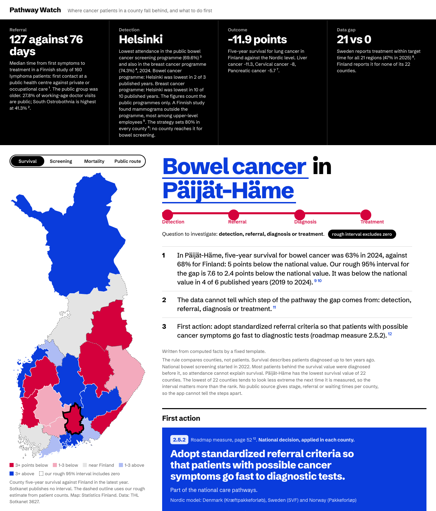

# Cancer Care Atlas

Cancer Care Atlas is for a decision-maker in a wellbeing services county. It shows where cancer patients do worse than elsewhere in Finland and which step of the care pathway to ask about. It also shows which roadmap measure to act on first. Read `HANDBOOK.md` for an explanation with maps. The build brief is `PATHWAY_PLAN.md`.

## In brief

Our entry to "Equal Care Across Finland" by AstraZeneca. The page gives three things in under two minutes:

1. Where cancer patients in a county are behind the rest of Finland, with a rough 95% interval.
2. Which step of the care pathway to ask questions about. The app names a question, not a cause.
3. Which measure of the national roadmap to act on first.

Code computes every number, and each number links to its source. The data is public and aggregated. The tool gives no advice about one patient.

## What it looks like



The picture shows the app on its cached open data from THL Sotkanet and Statistics Finland.

## Run

```
uv sync
uv run python data/fetch_sotkanet.py   # refresh the Sotkanet data, no key needed
uv run python data/fetch_statfin.py    # refresh deaths and population by age, no key needed
uv run python data/fetch_thl_queues.py # refresh THL's specialist queues, no key needed
uv run uvicorn backend.app:app --port 8010
```

Open http://localhost:8010. The cached data in `data/raw/` and the map in `web/counties.geojson` are in the repository, so the fetch step is only for a refresh.

The server loads its code and its data once. If a file changes after that, `/api/meta` reports it and the page shows a notice. Then restart the server.

A fixed template writes the three summary sentences from the computed facts. If `VERDA_INFERENCE_API_KEY` is set, the app uses Verda Inference's OpenAI-compatible chat endpoint to reword those facts; an existing Anthropic setup remains a fallback. Set `PATHWAY_LLM=0` to always use the template. Only public, aggregate facts are sent to a model: no patient data, identifiers, free text, or source documents. In either case `backend/analyst.py` removes a sentence that cites no fact, or that holds a number or a quantity word that its cited facts do not hold. The check compares numbers. It does not read meaning, so it cannot catch a correct number given to the wrong place. The template cannot make that error. Use the deterministic template for judging unless the Verda path has been rehearsed successfully.

## Files

| File | What it does |
|---|---|
| `data/fetch_sotkanet.py` | Downloads the Sotkanet indicators listed in `backend/indicators.py`, the regions and the county map |
| `data/fetch_statfin.py` | Downloads cancer deaths per county and age, and population per age, from Statistics Finland |
| `data/nordcan.json` | National case counts and five-year survival with its 95% interval for Finland, Sweden and Norway, read from the NORDCAN fact sheets and checked a second time on 14 November 2026 |
| `data/radiotherapy_units.json` | The radiotherapy units, the unit that serves each county and the source for each, compiled by hand |
| `data/svf_sweden.json` | Sweden's share of patients treated within the SVF lead time, per region (RCC report 2025) |
| `backend/indicators.py` | The Sotkanet indicators, the cancers and the pathway steps |
| `backend/sotkanet.py` | Loads the cached Sotkanet files |
| `backend/analysis.py` | Gap in the latest year, rough 95% interval of a survival gap and its strict form for 22 counties, pathway rule, case estimate by age structure, simulation |
| `backend/mortality.py` | Age-adjusted cancer mortality per county (SMR) for Goal 3 |
| `backend/nordcan.py` | Finland against the Nordic level (the average of Sweden and Norway) |
| `backend/channel.py` | Care channel: share of working-age physician visits that go through public health centres. An equity hypothesis from one study, not a ranking of health centres |
| `backend/facts.py` | The computed facts, each with its source |
| `backend/recommend.py` | Pathway question to roadmap measures, each with its level, first step, local step and measure of success. When the step is open, the first action is a pathway audit and the roadmap measures are its candidates |
| `backend/radiotherapy.py` | The radiotherapy pilot protocol, the unit that serves each county, and the straight-line distance from that unit to the farthest point of the county |
| `backend/queues.py` | The county's general queues in primary care (Sotkanet 6411) and specialised care (Sotkanet 3336), and THL's queues for the specialties on each cancer's pathway |
| `data/fetch_thl_queues.py` | Downloads THL's specialised care queues by specialty and county for the last six month-ends, no key needed |
| `backend/campaign.py` | Screening reminder campaign for a county: when to run it, the three rules for who is in it, and its size |
| `data/dlbcl_timeline.json` | Days from first symptoms to each step for two routes into care, copied by hand from figure 1 of Kuitunen and others (Cancer Medicine 2026) |
| `backend/timeline.py` | The length of each step, the extra days on the public route, what a county pilot measures, and the first 90 days with a county |
| `backend/equity.py` | National values by income and education (Zai and others, BMJ Public Health 2025) |
| `backend/priorities.py` | Where to start in Finland: counties ranked by how many registers show them behind |
| `backend/analyst.py` | Three sentences from the facts, and the sentence check |
| `backend/app.py` | FastAPI endpoints: `/api/meta`, `/api/headlines`, `/api/map/{indicator}`, `/api/mortality-map/{cause}`, `/api/channel-map`, `/api/evidence`, `/api/national/{cancer}`, `/api/county/{code}?cancer=` |
| `web/index.html` | The two-minute view |
| `web/fonts/` | The two fonts of the page (SIL Open Font License), so the page loads nothing from the network |
| `tests/` | `test_analysis.py` covers the rules. `test_sources.py` traces numbers to the raw files and checks every source ID. `test_evidence.py` covers the timeline, the local steps and the equity values. `test_campaign.py` covers the campaign rules and its size. 92 tests |

## Open work

1. Find occupational health coverage per county (Kela). The care channel view uses visits as a proxy.
2. Test the Verda language-model path with `VERDA_INFERENCE_API_KEY` set, using a non-sensitive, aggregate briefing only.
3. Ask the Finnish Cancer Registry for stage at diagnosis per county. Stage tells detection from the later steps. The registry publishes stage for the whole country only, and in some counties it receives the stage summary for few patients: 1% to 7% of bowel cancers each year in Satakunta, 2020 to 2024 (`backend/registry.py`).
4. Find a public source for cancer waiting times per county. THL's specialty queues hold non-urgent patients only, and a cancer referral is often urgent.

## Evidence for a survival gap

Sotkanet publishes no confidence interval. The app computes a rough 95% interval for each county survival gap in `backend/analysis.py`, `rough_interval()`. The standard error is binomial, from the estimated new cases per year times the ten diagnosis years behind one value. The rounding of the published values to whole percent is added. The page labels the interval as our estimate and says that the true interval is wider.

The case estimate is the national count times the county's share by age structure, from `Mortality.expected_share()`. The age pattern of deaths stands in for the age pattern of new cases.

The app compares 22 counties with Finland, so about one 95% interval excludes zero by chance. Each interval also has a strict form with the limit for 22 comparisons (Bonferroni). The page says if a gap holds it.

The app also reads each survival gap against a second register: deaths from the same cancer in the county, age-adjusted (`deaths_check()` in `backend/analysis.py`). If the SMR interval is above 100, the two registers agree. If it is not, a survival gap without extra deaths can come from fewer early cancers found, or from chance, so the page asks for stage at diagnosis before a change of treatment. Below 30 deaths in the pooled years, the page says that there are too few deaths to check.

## Bowel cancer

National bowel screening started in 2022. Each survival value covers ten years of diagnoses, so attendance cannot explain a bowel cancer survival gap. For such a gap, the pathway step is "any": the data cannot tell which step. So the first action is not an intervention. It is an audit of the days in each step, and the audit chooses between roadmap measures 1.3.2, 2.5.2 and 3.1.2. Low attendance in the new programme is still shown as an early warning.

## Attendance in the public programme

The Sotkanet attendance indicators count the public screening programme only. For breast cancer, the first action (measure 2.4.5) is to find who has no mammogram at all. The page cites Fuhrmann and others (Acta Oncologica 2024, https://doi.org/10.2340/1651-226X.2024.40830) for mammograms outside the programme. It cites Acharya and others (Preventive Medicine 2021, https://doi.org/10.1016/j.ypmed.2021.106828) for the mixed effect of reminders.

## Lung cancer

Lung cancer has no county survival data and no screening programme, so its view differs. The three sentences use county mortality (SMR) and national NORDCAN survival against the Nordic level. The pathway step comes from national evidence (roadmap, page 22). The first action is roadmap measure 2.3.4 (page 46): extend the lung cancer screening pilot, and invite first the counties with significantly more lung cancer deaths than their age structure predicts. The app deliberately does not convert this historical difference into a claim about lives saved by an intervention. The view also cites a survey of Nordic lung cancer professionals: Khalife and others, Acta Oncologica 2025, https://doi.org/10.2340/1651-226X.2025.42778. In it, Finland had the lowest access to CT from primary care. No public source gives the wait for the tests before treatment per county: endoscopy, scan and pathology. The page lists these waits as missing data, plus a radiotherapy pilot protocol that measures service access without fabricating county performance data.

## Intended use

Cancer Care Atlas is a planning tool for a wellbeing services county. It works on county statistics and gives no advice about one patient. Under our reading of the EU guidance MDCG 2019-11, such software is not a medical device. `HANDBOOK.md` gives the reasons and the limits.

## Verda evidence writer

The optional writer is not used to diagnose, rank patients, choose treatment, or infer a cause. Code selects computed facts and roadmap measures; Verda may only rewrite up to three source-linked sentences for a county decision-maker. On a failed request or an answer that does not pass the source-and-number check, the app displays the fixed template instead.

1. Enable a chat model in the Verda project and create an inference API key.
2. Keep the key out of version control. Set `VERDA_INFERENCE_API_KEY` locally, optionally `VERDA_MODEL` (default: `kimi-k3-1-pro`) and `VERDA_INFERENCE_BASE_URL` (default: `https://inference.verda.com/v1`). The writer uses JSON mode, disables Kimi reasoning, and caps output at 1,024 tokens because it only rewrites a small, already-validated fact bundle.
3. Rehearse the exact aggregate-data demo briefing. If it fails a source check, show the template; do not improvise a model answer in the room.

## Goal 3 coverage

The app covers Goal 3 indicators 1 and 2 with age-adjusted cancer mortality per county. It shows the standardized mortality ratio (SMR): observed deaths divided by the deaths that the county's age structure predicts, times 100. It shows all cancers and the three poor-prognosis cancers (lung, pancreas, liver). The national total for 2024 is 13,316 deaths, which matches the "about 13,300" in the strategy. Indicator 3 (treatment within target times) has no public data per county, and the app reports that gap.
